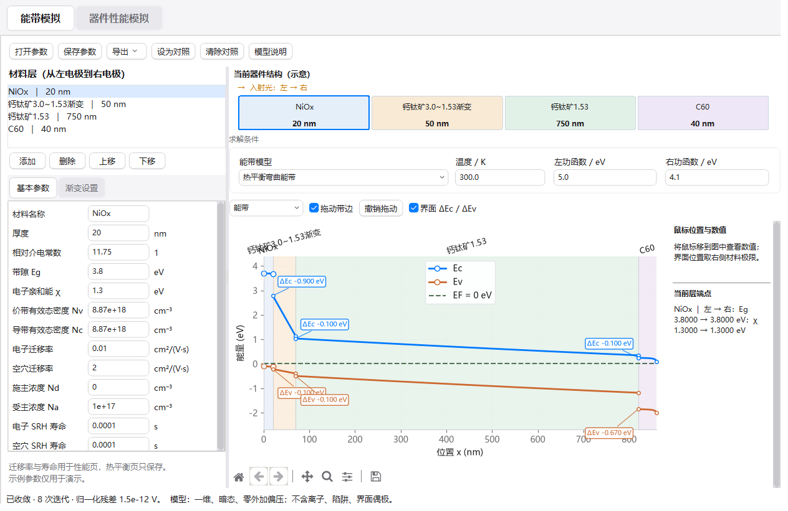
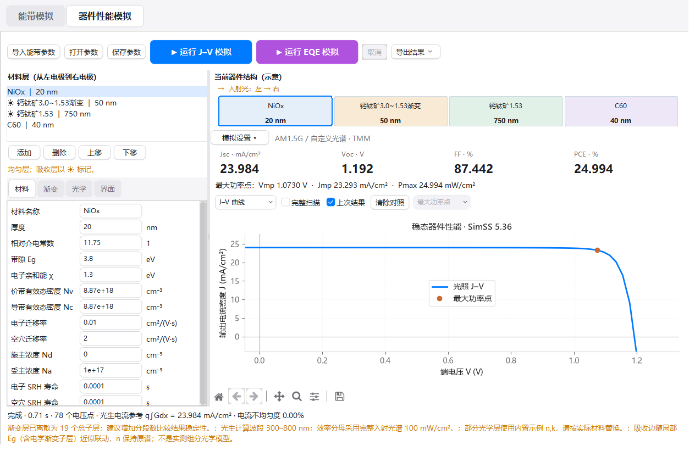

# macOS 风格界面 · 1.4.0

两个页面采用与「文献管理工具」相近的浅色样式：浅灰背景、白色内容区、深灰文字、蓝色强调和细分隔线。保留现有页面布局、模拟功能、原图标和 MK Design 签名。

| 元素 | 样式 |
| --- | --- |
| 主要配色 | 背景 `#f5f5f7`、内容 `#ffffff`、文字 `#1d1d1f`、辅助文字 `#6e6e73`、强调 `#007aff` |
| 按钮 | 圆角、细边框与轻阴影；悬停、按下、焦点及禁用状态尺寸一致 |
| 运行按钮 | J–V 蓝色、EQE 紫色，同尺寸大按钮；保留原有运行与取消行为 |
| 表单 | 圆角输入框 / 下拉栏；蓝色焦点边框、灰色禁用态；均匀 / 渐变输入规则不变 |
| 页签 | 灰色分段式页签、白色选中项，选中时不改变尺寸 |
| 列表与选项 | 浅蓝选中行、蓝色复选标记、圆润滚动滑块及一致的菜单配色 |
| 器件结构 | 彩色圆角材料卡片，名称、厚度和入射光箭头仍按当前器件更新 |
| 图表 | 白色图面、浅灰坐标与分隔线；工具栏统一样式，保留导航、平移、框选缩放及保存 |

圆角控件由 Pillow 在本机绘制，无需下载主题或字体。程序仍是 Windows 应用，系统标题栏及原生文件对话框沿用系统样式。按用户要求，本次不调整 DPI / 清晰度设置。

## 验证

- 完整测试集 70 项通过，覆盖真实 SimSS、能带拖动、光学、J–V、EQE、损失分析、导出及输入状态。
- 增加图表工具栏实际按钮切换、选中状态同步、历史前进 / 后退及图像缩放重绘检查。
- 另通过实际滚动条滑块拖动检查；自绘元素保留 Tk 要求的 `thumb` 名称后缀。
- 检查 900×560、1024×650、1320×880 窗口，并更新真实界面截图。两个主要运行按钮保持 45 px 高度，窄窗口继续沿用已有的结构图移位与表单滚动。
- 模拟方程、材料参数和历史研究数据未修改。

