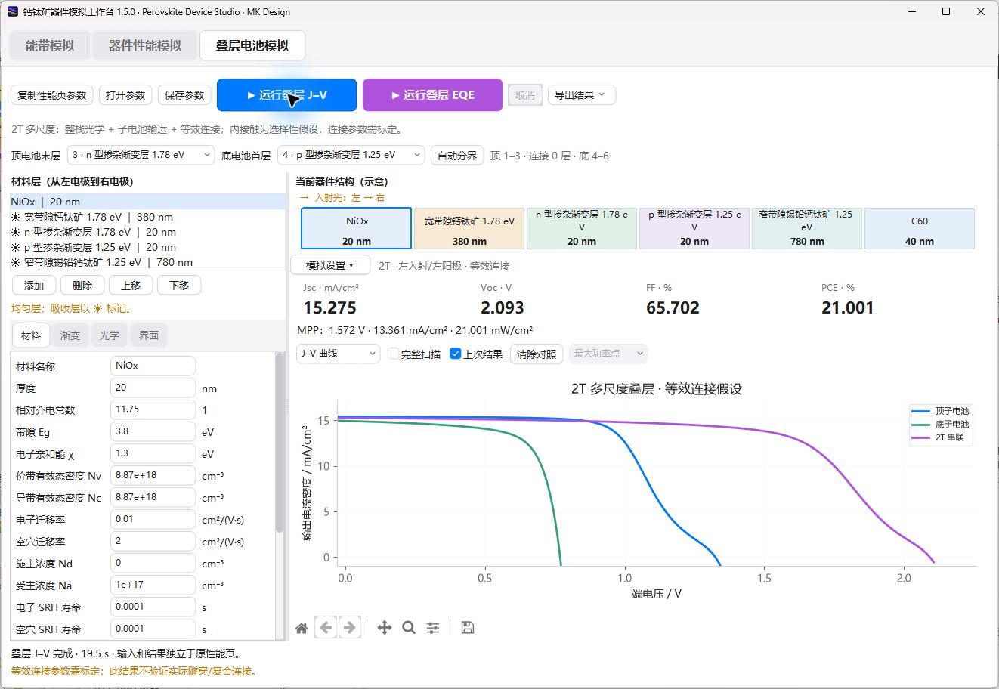
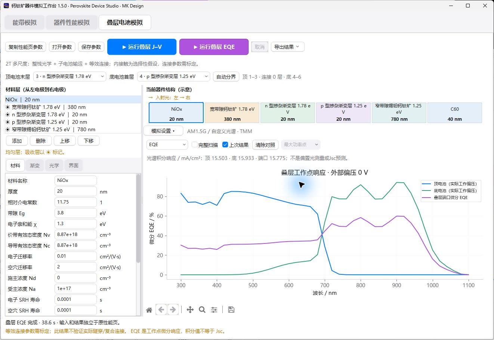

# 2T 叠层电池模拟（1.5.0）

新选项卡「叠层电池模拟」采用**多尺度等效连接模型**。它求解整栈光学、两个子电池的漂移扩散输运，以及串联电路的共同工作电流。它能比较子电池设计和给定连接特性下的性能，**不能从低掺杂 n/p 接触的材料参数自动预测隧穿或复合连接是否成立**。原「器件性能模拟」仍是整栈单域异质结求解；两页的输入、J–V 和 EQE 相互独立。

## 操作

1. 点击顶部第三个选项卡。首次显示内置 1.78 / 1.25 eV 示例：NiOx 20 / 宽带隙 380 / n 渐变 20 / p 渐变 20 / 窄带隙 780 / C60 40 nm，AM1.5G、300–1100 nm。两侧钙钛矿及 n/p 层均参与光生；n,k 为原文献代理组分，NiOx 仍为原 PTAA 光学示例映射，未增加材料层。
2. 「复制性能页参数」只复制当前输入；也可直接打开性能参数、旧串联参考输入、新叠层输入或完整结果 JSON。完整结果仅载入输入，须重新运行；当前成功结果仍保留。
3. 在上方指定**顶电池末层、底电池首层**。前者从 1 计数为 a，后者为 b+1：顶电池包含 1…a 层、底电池包含 b+1…N 层，中间 a+1…b 层属于等效连接区。两个子电池均须有光生层。默认在原 n/p 之间划界，中间区为零层，n/p 分别保留在各自子电池。也可把两层 20 nm 单独划为等效连接区。更改分界会改变模型假设，须分别对照。
4. 展开「模拟设置 → 叠层与连接」。选择理想连接、电阻连接或等效复合结。默认为面积电阻 0.1 Ω·cm²；J0=100 mA/cm²、n=1 仅为非线性模式的**演示参数，未经材料标定**。
5. 自动内接触默认距对应带边 0.15 eV，极窄带隙时限制为 Eg/4：顶子电池右侧电子接触 W=χ+δ；底子电池左侧空穴接触 W=χ+Eg−δ。也可取消自动，填禁带内功函数。内接触默认多数载流子速度 1e7 cm/s、少数载流子阻挡；这是假设边界，并非物理材料层。
6. 运行叠层 J–V。可切换子电池参数、电流匹配、连接损失、入射光谱和 G(x)。外部 Rs/Rsh 及入射功率均只计一次。子电池自动按吸收层带隙确定扫描范围；原设置中的扫描起止不用于串联组合，vstep 仍控制子电池扫描分辨率。覆盖不足或明显非单调时明确拒绝，不外推。
7. 「EQE」设置波长步长、探测通量和背景比例（须 >0）；「叠层与连接」设置外部工作电压，默认短路 0 V。运行 EQE 得到该工作点下的子电池及端口微分响应。可导出每个视图 CSV、完整 JSON 和带模型标记的 PNG/SVG。修改输入、计算失败及取消均保留成功结果；导出始终对应成功计算快照。

小屏幕沿用可折叠设置、滚动表单及自动移位的结构图；J–V 和 EQE 保持同尺寸强调按钮。





## 计算路径

### 一次光学计算，两个电学区域

SimSS 原生法向 TMM 在完整光学堆栈上计算 G(x)，包括薄膜干涉、遮挡和寄生吸收。新增的 `PDS_OPTICS_ONLY=1` 原生入口在初始化 G(x) 后退出，不求解整栈电学，因此中央电学不收敛不会阻止提取光生分配。普通模拟明确移除此环境变量，行为不变。

G(x) 在分界处线性插值，精确拆分为顶、连接、底三区，并验证 q∫Gdx 守恒；随后输入各子电池的 SimSS 方程。子电池内部的体 SRH、辐射复合、迁移率、渐变、界面陷阱等沿用原模型。其末端跨域界面以及连接区的电学由等效连接代替，**这些界面的 Nt 不再重复作用，也不自动换算为 J0**。独立光学阶段清零界面陷阱仅因其不参与 TMM；子电池内部界面仍保留。

两个电学网格对 G 的再次插值会产生离散误差；累计误差超过 1%（或绝对 0.05 mA/cm² 的更大阈值）拒绝结果；结果 JSON 含 `generation_audit`。光伏工作区电流不守恒超过 0.5% 也拒绝。

### 共同电流与连接

输出电流取正；J、J0、Jph 使用 mA/cm²，面积电阻 Ω·cm²，电压 V。令 Js 为串联支路电流、Vc 为连接压降：

```text
理想连接：Vc = 0
电阻连接：Vc = Js Rc / 1000
等效复合结：Vc = n kT/q · ln[1 + (Js + Jph,c)/J0] + Js Rc/1000
Jph,c = ηc · q∫连接区 G(x)dx

Vi = Vtop(Js) + Vbottom(Js) − Vc(Js)
Jext = Js − 1000 Vi/Rsh
Vext = Vi − Jext Rs/1000
```

等效复合结由 `Js = J0[exp(Vd/nVt)−1]−Jph,c` 反解，代表正向复合通道的现象学特性；不含反向击穿。J0 越大，给定 Js 的压降越小。连接区吸光在该模式下会产生对串联电压不利的光电压；理想/电阻模式假定它不产生额外电压。**没有独立连接层也可设置边界连接模型，但这仍是对实际接触的假设。**

子电池 J(V) 单调性通过检查后反演，在共同电流范围内组合，禁止外推。深反偏饱和区的微小数值波动允许作单调包络，最大修正量存入结果；明显非单调曲线拒绝。全局 Rsh 跨接内部串联堆栈，随后连接全局 Rs。串联电压不是把两个独立最大功率点电压直接相加。整器件效率为 max(Vext·Jext)/Pin；两个子电池各自 PCE 也以同一整器件 Pin 为分母。

连接损失视图在短路、MPP、开路显示：

```text
Js·Vtop + Js·Vbottom
  = Js·Vc + Jext²·Rs/1000 + 1000 Vi²/Rsh + Jext·Vext
```

此为电路功率收支，不是相对理想辐射极限的完整光子/热化/复合损失分解。`power_residual` 用于数值核对；不能把整器件全部损耗都归入 Rc。

### EQE 是工作点响应

先在给定背景光与外部偏压求串联工作点，再固定各子电池的实际偏压逐波长叠加 1 nm 弱探测光，以 DD 求局部微分光响应。电路雅可比把两个响应耦合成外部固定偏压的微分电流。

设 rt=−dVtop/dJs、rb=−dVbottom/dJs；复合结 rd=nVt/(J0+Js+Jph,c)，其他模式 rd=0；rc=Rc/1000（理想模式为 0）。

```text
D = (rt+rb+rd+rc)(1+Rs/Rsh) + Rs/1000
端口 EQE = (rt·EQEtop + rb·EQEbottom − rd·ηc·Aactive,c) / D
```

因此一侧响应可能被电流匹配限制，连接区光生贡献也可能为负。结果不剪裁到 0…1；含数值误差估计。光谱积分使用**该背景的实际光谱**，积分值标为“积分响应”，不能当成端口 Jsc。没有模拟实验测量中独立照亮另一子电池的偏置光过程。减半探测通量、减小波长步长及细化网格是必要的定量核对。

## 适用范围

该功能适合比较在**明确内接触与连接特性假设下**，厚度、能级、复合、光谱、匹配和连接压降的趋势。不是微观隧穿、简并统计、全堆栈统一电势、离子迁移、光致相分离或发光耦合求解器。改变掺杂不能自动产生真实的高效中间连接。要把结果用于样品性能预测，需要各子电池和连接的独立实验标定，以及网格、探测通量和波长分辨率核对。

漂移扩散底座及来源：[SIMsalabim 5.36](https://github.com/kostergroup/SIMsalabim/tree/v5.36)、[JOSS 论文](https://doi.org/10.21105/joss.03727)。等效单二极管方程的标准形式参见 [pvlib 文档](https://pvlib-python.readthedocs.io/en/v0.13.0/reference/generated/pvlib.pvsystem.singlediode.html)；这不代表 pvlib 或上游验证了本项目的实际连接材料。原生改动见 [求解器来源与构建说明](../vendor/simsalabim/PROVENANCE.md)，数值检查见 [1.5.0 验证记录](verification-1.5.0.md)。
