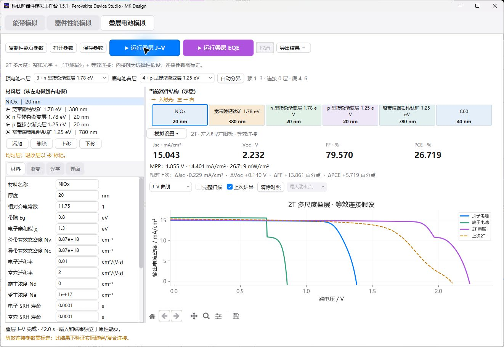

# 1.5.1 验证记录

- 叠层页新增相对上次成功J–V的四项差值，Jsc用mA/cm²、Voc用V、FF和PCE用百分点，带正负号。
- 修改参数、切换非EQE视图时保留快照比较；EQE视图隐藏J–V比较行，切回恢复；清除对照移除差值与历史曲线。失败或取消仍保留成功结果。
- 低屏高时采用紧凑比较行，Jsc/Voc单位沿用上方指标标签，FF/PCE仍注明百分点；暂收起MPP辅助行，完整MPP仍在子电池参数和导出中可见，给图表留空间。
- 叠层页与原性能页共18项针对性界面检查通过；最终单位文字微调后，差值/视图/快照/900×560布局的新增检查再次通过。1.5.0已有93项整体回归记录；本次未改物理模型、原生求解器或数据接受阈值。
- 新研究使用实际SimSS求解、共同电流电路、参数不变量断言、光生重映射/电流守恒检查、细网格和步长核查。报告保留失败及不稳定候选，未把粗筛超过30%的结果当作达标。

研究结果与复现见 [无减反掺杂优化](../research/2026-11-16/01_no_arc_doping/README.md)。推荐对照效率约26.719%，并非30%；虚拟内接触和等效连接仍需标定，不直接代表实验器件。

Windows单文件版实际载入内置同网格基准及线性掺杂优化项目，连续运行成功：基准38.4s、优化42.0s。界面ΔJsc−0.229、ΔVoc+0.140、ΔFF+13.861、ΔPCE+5.719，与后端成功快照一致。单文件与文件夹版1415项资源逐项核验，标准库ZIP各条目内容一致；版本、原生求解器和新参数文件已核对。

