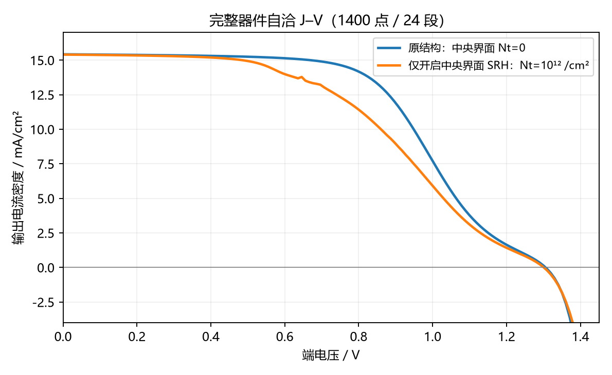
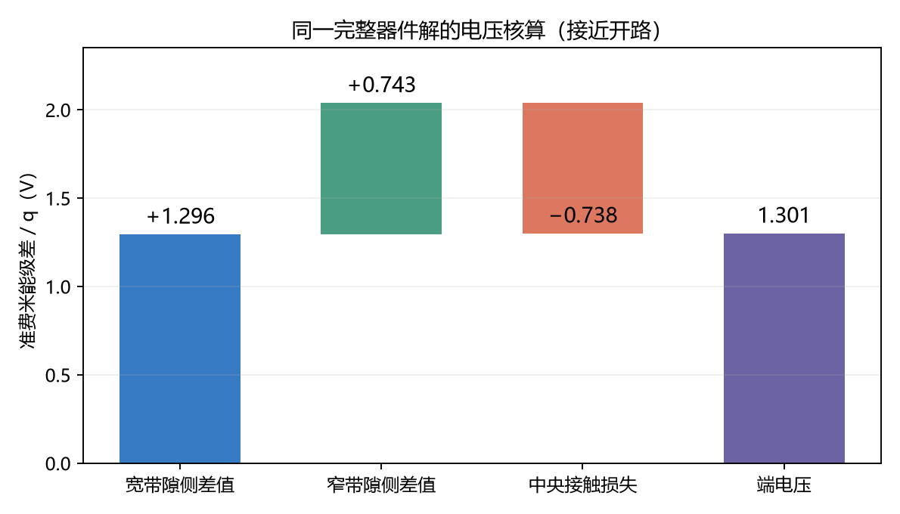
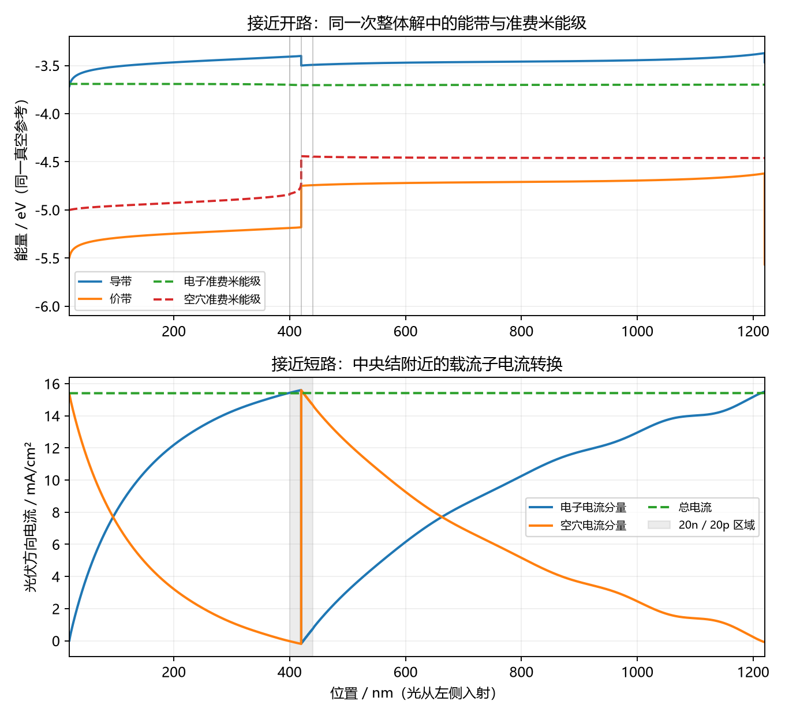

# 原页面完整器件中央连接核查（2026-11-15）

普通 J–V 可以继续求解整个结构；本次没有增加页面、按钮、虚拟内接触或独立材料层。修正了 SimSS 5.36 的稳态界面 SRH 数值雅可比，并在开启界面陷阱时加强密度松弛。**这修复收敛问题，不会自动得到理想串联或 30% 效率。**

## 结构与结果

NiOx 20 / 1.78 eV 宽带隙 380 / n 渐变 20 / p 渐变 20 / 1.25 eV 锡铅窄带隙 780 / C60 40 nm。n/p 中央峰值各 10¹⁶ cm⁻³，向外渐变至 10¹⁴；χ 宽/窄 = 3.8/3.9 eV。四个钙钛矿区域均产生光载流子。

沿用 2026-11-13 的文献代理 n、k 和 300–1100 nm AM1.5G 光学基准，没有使用后续亲和能设计、减反层或提高迁移率/寿命假设。原结构中央 Nt=0；对照仅改成中性界面 Nt=10¹² /cm²，Cn=Cp=10⁻⁸ cm³/s，能级取共同禁带中点，其余物理参数不变。**高 Nt 为机制诊断，未作为已测量或推荐的优化参数。**

| 中央 Nt / cm⁻² | 网格 / 渐变分段 | Jsc / mA/cm² | Voc / V | FF / % | PCE / % | 工作区 RMS 电流误差 / 光生电流 |
|---|---|---|---|---|---|---|
| 0e+00 | 1400 / 24 | 15.4277 | 1.3057 | 56.55 | 11.391 | 0.0004% |
| 0e+00 | 700 / 12 | 15.4924 | 1.3063 | 56.55 | 11.445 | 0.0005% |
| 1e+12 | 1400 / 24 | 15.4050 | 1.3011 | 46.17 | 9.253 | 0.0444% |
| 1e+12 | 700 / 12 | 15.4696 | 1.3016 | 46.21 | 9.305 | 0.0444% |

700/12 → 1400/24 时，指标相对变化均小于 0.6%。全部采用完整成功退出的曲线；失败试算没有作为有效性能。误差按 0 ≤ V ≤ Voc 的光伏工作区统计，分母采用总光生电流，避免用强正向注入电流掩盖误差。网格检查同时细化了空间点数和渐变分段，不能分别归因。



## 为什么还只有约 1.30 V

对 Nt=10¹² 的 1400 点结构，在单独重算的接近开路点，端电压 1.301056 V，输出电流 0.000438 mA/cm²。由**同一个完整解**的电化学势核算：

```text
宽带隙侧抽取端准费米差： 1.296178 V
窄带隙侧抽取端准费米差： 0.743334 V
中央 n/p 准费米差损失：−0.738239 V
两侧外端差值：          1.301273 V
器件端电压：            1.301056 V
```

上述两侧差值不是分别求解的独立子电池 Voc；式子是对同一次整体计算的电压核算。残差约 0.00022 V 为外侧传输/接触差值。中央界面可以转换电子、空穴电流，但仍需约 0.738 V 的准费米能级差，未形成低损耗内连接。提高 Nt 并未提高 Voc，还降低了 FF；不能把普通界面缺陷浓度直接当成“理想隧穿结开关”。




## 对“不加功能”的结论

保留当前页面、功能层编辑及普通 J–V 按钮是可行的，本次已这样修正后台。现有界面 SRH 提供一种非简并、陷阱辅助连接的物理近似，可以研究其损耗；当前 20n/20p、10¹⁶ cm⁻³ 的参数没有证明能够高效串联。

要预测低损耗真实叠层连接，需要已有两层具有实际可实现的选择性和复合能力，并有对应材料/接触数据。若依赖重掺杂隧穿，则现有后台没有带间隧穿、非局域隧穿和简并统计，不能仅无限提高掺杂、Nt 或强行相加电压替代。无需新增界面页面，但必要的物理模型与参数验证无法省略。这次没有加入这些新物理机制。这些对照只说明当前参数集的表现，不能据此断言所有无独立互联层结构都不可行。

1.4.1 的约 2.07 V、29.66% 是带虚拟选择性内接触的独立串联参考，仍不能当作本结构已经实现的性能。

## 数值修正与复现

引擎 5.36-pds2，SHA256 `6d251ec931832854ee35045e3deb6273d60af360c244b8e55159c7e202db9d72`。原始复合率、光学和物理方程未改。雅可比仅保留界面两个点的自项/邻项，纠正电子邻项符号、空穴误用电子密度及分子项；生产 Pascal 例程 128 项中心有限差分全部通过，最大相对误差 7.5×10⁻⁹。原实现使用中央界面输入核对时 64 项中 20 项失败，修正后 64 项全部通过。

开启有效界面 SRH 时固定松弛 0.05、最多 100000 次迭代，仍要求密度与电流同时收敛，沿用用户超时并拒绝失败的部分输出。正式对照扫描 −0.02–1.50 V、步长 0.01 V；此前 350 点完整 0–2.30 V 扫描也只见约 1.30 V 零电流点，没有把扫描上限视作 Voc。

1. 用 1.4.2 性能页打开 `parameters/original_Nt0.json` 或 `parameters/interface_Nt1e12.json`。
2. 点击原来的“运行 J–V 模拟”。保留文件中的网格、光谱和 120 秒超时设置。
3. `data/metrics.*` 为粗/细网格指标，`*_JV.csv` 为原生 SI 电流及误差，`*_delivered_JV.csv` 为软件端电压/输出电流。
4. `SC/MPP/near_OC_spatial_SI.csv` 为独立工作点的原生空间数据；x 为 m，n/p 为 m⁻³，J 为 A/m²，G 与界面网格化复合率为 m⁻³s⁻¹，Ec/Ev/phin/phip 为 eV。`IntSRHn/p` 是界面率分配到网格后的体积率，不能直接当 cm⁻²s⁻¹。
5. 研究 ZIP 中保留完整输入、原生 JV/Spatial/log，以及失败状态和试算脚本。Git 目录保留精简、可核查的数据；不会覆写先前研究。

依据：[SimSS 官方模型手册](https://raw.githubusercontent.com/kostergroup/SIMsalabim/master/Docs/Manual.pdf) 的界面陷阱可与两侧载流子交换；[分发源码与修改记录](../../../vendor/simsalabim/PROVENANCE.md)。材料光学代理及适用边界沿用 [2026-11-13 光学基准](../../2026-11-13/02_extended_optics/README.md)，尚未按实际样品标定。
