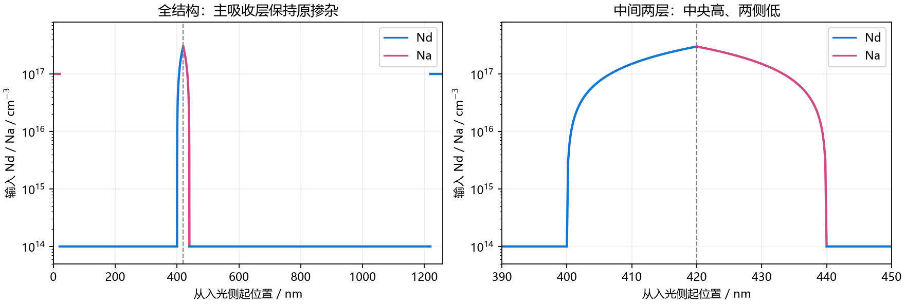
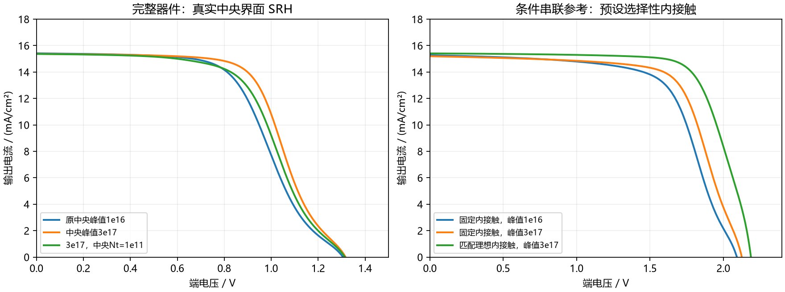
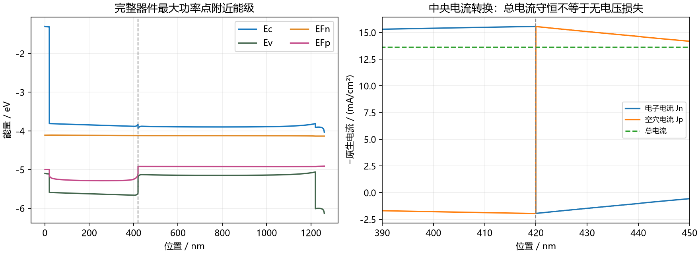

# 中央高掺杂 n/p 渐变层：纠正结构后的重算

已纠正上一轮结构：380/780 nm 主吸收层恢复原来的均匀弱 n 型掺杂；只提高中间 20 nm n 层和 20 nm p 层在相互接触处的掺杂。没有增加独立互联材料或减反层。**本次尚未证明真实中央接触能实现低损耗串联或 30% 效率。**

[离线图文报告](报告.html) · [最终性能 CSV](final_performance.csv) · [输入参数库](../../../device_structures/README.md)。全部参数内嵌文献代理 n,k，需从对应页面打开参数文件，不能只改几项掺杂后与其他旧设置比较。

## 这次使用什么参数

层序为入射光 → NiOx 20 / 宽带隙 380 / n 渐变 20 / p 渐变 20 / 窄带隙 780 / C60 40 nm。下表沿此方向读取左右端值，浓度单位 cm⁻³：

| 区域 | Eg / χ（eV） | Nd 左→右 | Na 左→右 |
| --- | --- | --- | --- |
| 宽带隙主吸收层 380 nm | 1.78 / 3.8 | 1e14，均匀 | 0 |
| n 型渐变层 20 nm | 1.78 / 3.8 | 1e14 → 3e17，线性 | 0 |
| p 型渐变层 20 nm | 1.25 / 3.9 | 0 | 3e17 → 1e14，线性 |
| 窄带隙主吸收层 780 nm | 1.25 / 3.9 | 1e14，均匀 | 0 |

主吸收层 Nd=1e14、Na=0 与原始输入完全相同，窄带隙主层没有被擅自改成 p 型。p 渐变层外端 Na=1e14 也保留原设计。中央峰值测试 1e16、1e17、3e17；3e17 是本次非简并模型内的较高测试点，并非已确认的材料最优值。掺杂值按有效电离施主/受主处理，不能直接等同于前驱体加入量或界面自由载流子密度。

四个钙钛矿区域均开启产生光载流子。保留 Nc=Nv=3e18、μn=μp=2 cm²/V/s、τn=τp=1e-4 s、体缺陷1e15 cm⁻³、B=1e-10 cm³/s；其余原材料参数、原χ、外功函数5.0/4.1 eV、Rs=0.3 Ωcm²、Rsh=4e4 Ωcm²不变。AM1.5G 300–1100 nm、100 mW/cm²，Air 前侧占位不提供减反作用，背面 Ag 100 nm。n,k 是已有组分代理，NiOx仍沿用原PTAA光学代理，未按实际薄膜标定。



## 完整器件与条件串联分别得到什么

| 模型与条件 | Jsc / mA cm⁻² | Voc / V | FF / % | PCE / % |
| --- | ---: | ---: | ---: | ---: |
| 完整器件：原中央峰值1e16 | 15.4170 | 1.3057 | 56.5407 | 11.3820 |
| 完整器件：中央峰值3e17 | 15.3763 | 1.3168 | 62.1608 | 12.5863 |
| 完整器件：3e17，中央Nt=1e11 | 15.3659 | 1.3140 | 57.9405 | 11.6990 |
| 条件串联：固定内接触，峰值1e16 | 15.2733 | 2.0924 | 65.7099 | 20.9993 |
| 条件串联：固定内接触，峰值3e17 | 15.1918 | 2.1260 | 69.5820 | 22.4732 |
| 条件串联：匹配理想内接触，峰值3e17 | 15.4091 | 2.1883 | 74.4417 | 25.1011 |

**完整器件**用同一空间解计算所有层、电势与中央界面，原中央 Nt=0；峰值提高后 PCE 从11.3820%到12.5863%，FF从56.5407%到62.1608%，但 Voc仅从1.3057到1.3168 V。这是现有完整漂移扩散/复合模型的结果，不是对实际样品的预测。

**中央 SRH 诊断**只在 n/p 接触处增加中性界面 Nt=1e11 cm⁻²、Cn=Cp=1e-8 cm³/s，能级取共同禁带中点，得到11.6990%。另测 Nt=1e12，1400/24网格为10.8094%；增大普通陷阱没有产生理想复合连接，反而损失FF。捕获系数、Nt属于机制敏感性假设，未由实验拟合，不作为推荐缺陷密度。

**条件串联**把完整光生分布分给两子电池，预设理想选择性内接触和中央连接电阻0.1 Ωcm²。固定内功函数3.95/5.00 eV时，峰值提高使20.9993%到22.4732%。再把理想内功函数改成随峰值平衡匹配的3.8595/5.0905 eV时，可得到25.1011%；**这个额外提升同时包含内接触边界的改变，不能归因于纯掺杂，更不能说是真实 n/p 接触已实现25.1%。** 内功函数计算采用 χ+kT ln(Nc/Nd) 和 χ+Eg−kT ln(Nv/Na)，只是理想边界设定；0.1 Ωcm²也不是从该掺杂推导出的真实连接电阻。叠层页不会由跨分界面的Nt自动求出连接电阻/复合J0。



## 为什么电子、空穴到了中央，电压仍相加不起来

你提出的方向是正确的：n 层向中央提高施主、p 层向中央提高受主，可在准中性梯度区域形成有利于相应多数载流子向中央输运的扩散场。但中央 n/p 结的耗尽区仍会产生势垒；电流到达界面，并不等于能在几乎零电化学势差下复合。

对峰值3e17、Nt=1e11的同一次完整器件空间求解，接近开路的实际端电压为 1.315008 V，输出电流 -0.026242 mA/cm²。电压核算为：

```text
宽侧抽取端准费米差      1.313624 V
+ 窄侧抽取端准费米差    0.837142 V
− 中央 n/p 准费米差     0.835728 V
= 两外侧吸收层抽取端差  1.315037 V
器件端电压              1.315008 V
```

这是同一个完整状态的电压账本，上面两侧差值不是独立子电池的Voc；各边界取相邻对应材料网格点。其余差值来自外侧传输/接触。原生 Jn/Jp 的转换显示中央存在复合交换，同时仍有显著准费米差及非理想选择性。不能将界面复合电流大直接解释为高效率串联。

| 状态 | 实际端电压/V | 输出电流/mA cm⁻² | 宽侧准费米差/V | 窄侧准费米差/V | 中央差/V | 外端差/V |
| --- | ---: | ---: | ---: | ---: | ---: | ---: |
| SC | 0.000390 | 15.367487 | 0.159184 | 0.809169 | 0.822542 | 0.145812 |
| MPP | 0.860922 | 13.592202 | 1.002901 | 0.784324 | 0.797282 | 0.989944 |
| near_OC | 1.315008 | -0.026242 | 1.313624 | 0.837142 | 0.835728 | 1.315037 |

SC、MPP、near_OC为空间单点求解，选用完整JV中最近实际记录的内部电压Vint；不是精确短路/MPP/开路。已核验单点与原JV电流差小于0.01 mA/cm²，报告保留实际Vext。原生SI表和便读单位表均在spatial目录，电流原生正号与输出电流正号相反。



## 为什么没有直接把峰值填成1e19

本引擎使用非简并玻尔兹曼统计，没有费米–狄拉克简并统计、带间或非局域隧穿。当前 Nc/Nv=3e18 cm⁻³；若直接填1e19，已经大于有效态密度，不能凭一个能运行的数值就给出可靠效率。真实重掺杂还需要电离、缺陷、迁移率、Auger/带隙变化等材料数据；本次没有通过修改态密度或寿命掩盖这些限制。

仅为理解尺度，按对称突变均匀结、εr=6.55、固定耗尽电势1.2V，W≈√(4εV/qN)：1e16、1e17、3e17、1e18、1e19对应约417、132、76、42、13 nm。**这不是当前有限厚度渐变异质结的耗尽区解，也不是隧穿电流预测**，只说明把两侧提高至1e16并不足以自动形成很薄的高效连接；即使估计宽度变薄，仍须有实际的复合/隧穿通道。

可验证的下一步应是为这两层本身补充适用的重掺杂/隧穿或经实验标定的界面复合模型，而不一定增加独立材料层。现有模型能做上述提取趋势与损失对照，不能证明所有无独立互联材料的结构都不可行。

## 数值和复现

本次8组完整器件粗扫、4组细化、3组进一步细化，共15条完整器件JV；另9条条件串联参考。主完整器件结论采用2000点/40分段/0.005V；固定内接触对照为1400/24/0.01V，匹配内接触参考为2000/40/0.005V。全程沿用生产求解器、原始接受规则，未把扫描上限当Voc，未采用失败/部分/非有限结果。

1400/24/0.01V → 2000/40/0.005V：完整器件原峰值11.3908→11.3820%，高峰值无界面陷阱12.6030→12.5863%，高峰值Nt1e11诊断11.7539→11.6990%；匹配内接触参考25.0996→25.1011%。网格/分段/步长共同变化，不分别归因，也不宣称严格数学收敛。粗/细Nt1e12诊断存在约0.27个百分点差异，因此不将其作定量优化方案；其FF下降的方向与其他对照一致。

生产引擎5.36-pds3；各原生运行日志/电流误差与完整结果保留。完整器件光伏区最大原生errJ/总光生电流小于0.5%才接受，具体比值见summary与numerical_check.json。

按顺序运行 study.py、refine.py、converge.py、fixed_contacts.py、report.py。Python环境安装项目requirements，使用配套SimSS 5.36-pds3。最终参数库的“完整器件/界面SRH诊断”文件在**器件性能模拟**页打开；两份“串联参考”在**叠层电池模拟**页打开。1.5.1程序可用，不需要重新打包。两种页面代表不同模型，结果不应混用。

Git保留汇总、两列JV、所选自包含参数、空间原始数据与复现脚本；全部原生多列JV、日志、全部输入和完整JSON gzip另放在[研究数据发布页](https://github.com/mumium/perovskite-device-studio/releases/tag/research-2026-11-16-center-peak-np)。ZIP中的SHA256清单可核对文件完整性。

上一轮26.7191%改变了两主吸收层的Nd/Na及中间梯度方向，属于另一种扩展结构，**不是你要求的中央高掺杂方案**；其原数据保留作为历史对照，不应继续作为本设计的优化结果。

依据：[SIMsalabim 5.36源码](https://github.com/kostergroup/SIMsalabim/tree/v5.36)、[本项目求解器修改记录](../../../vendor/simsalabim/PROVENANCE.md)。[Schramm等2024年电掺杂与PN结实验](https://advanced.onlinelibrary.wiley.com/doi/full/10.1002/adma.202314289)支持钙钛矿n/p电掺杂及费米能级调节的可行性，但不是本次峰值浓度、隧穿能力或效率的验证。光学来源沿用[300–1100nm文献代理研究](../../2026-11-13/02_extended_optics/README.md)。
