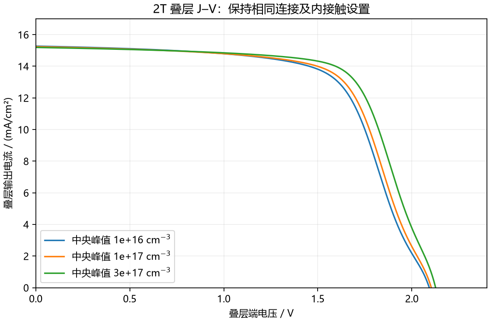

# 中央高掺杂渐变层：2T叠层性能重算

本报告只以软件“叠层电池模拟”页的2T串联为结果：顶子电池NiOx/380nm宽带隙/20nm n层，底子电池20nm p层/780nm窄带隙/C60。相同电流下相加两子电池电压，再计一次外电路损失。没有使用整栈单域JV的11%–12%数值作为叠层结果。

保留两个主吸收层原均匀Nd=1e14、Na=0；只改变中央两层：n20nm的Nd从1e14升至中央峰值，p20nm的Na从中央峰值降至1e14。二者另一掺杂种类均为0。厚度、Eg/χ、材料质量、光学与外接触均保持原值，无减反膜、无独立新增互联材料。四个钙钛矿区域均产生光载流子。

| n/p中央峰值 / cm⁻³ | Jsc / mA cm⁻² | Voc / V | FF / % | PCE / % |
| --- | ---: | ---: | ---: | ---: |
| 1e+16 | 15.2727 | 2.0926 | 65.7093 | 21.0007 |
| 1e+17 | 15.2375 | 2.1034 | 66.9959 | 21.4724 |
| 3e+17 | 15.1912 | 2.1263 | 69.5872 | 22.4778 |

三组均为2000空间点、40渐变分段、0.005V步长；AM1.5G 300–1100nm、100mW/cm²。采用相同固定虚拟内功函数3.95/5.00eV和面积连接电阻0.1Ωcm²，外Rs=0.3Ωcm²、Rsh=4e4Ωcm²。这样比较时不把内接触边界的改变算成纯掺杂收益。均通过现有生产路径完整成功计算及接受检查，没有采用失败的部分结果。

三组中最高为中央峰值3e+17：PCE=22.4778%。此前同条件1400点/24分段/0.01V的3e17结果为22.4732%，本次精细重算为22.4778%。最优仅指本次三个测试点，不代表已找到真实材料最优浓度。

该组顶/底子电池独立Voc分别为1.335977/0.791407V；经过全局并联与串联电阻后的叠层Voc为2.126341V。最大功率点内部共同电流为13.711032mA/cm²，顶/底电压分别为1.004808/0.645000V，扣除连接与外串联电阻压降后端电压为1.644335V。这是同电流下的串联求解。子电池最大原生errJ/光生电流为2.04e-07，工作点功率收支残差最大3.55e-15mW/cm²，均沿用原接受规则。详见tandem_only_validation.json。

另有一组3e17的**匹配理想内接触参考**已计算为Jsc15.4091mA/cm²、Voc2.1883V、FF74.4417%、PCE25.1011%；它还将虚拟功函数改为3.8595/5.0905eV，不能与上表当成纯掺杂对照。两种输入均已分开保存。

该2T页预设选择性内接触及等效中央连接，能给出叠层串联性能；它不从这两层掺杂和界面Nt自动求出真实隧穿复合能力。上述是明确连接假设下的叠层模型结果，不是实际n/p界面已高效连接的证明。没有为达到30%调整连接电阻或材料质量。

打开参数库“2026-11-16_中央高掺杂_np渐变_叠层性能重算.json”，必须在**叠层电池模拟**页打开并运行。它对应本表中最高的一组；其他组可按本脚本重算，全部JV、子电池曲线与工作点已随报告保存。当前1.5.1程序无需升级。

源数据：[性能CSV](tandem_only_performance.csv)、[精确汇总JSON](tandem_only_summary.json)；conditional/fixed_dense_*_JV.csv为串联输出，*_subcells.json为两个子电池JV、工作点、光生守恒及警告。完整输出JSON gzip另保留在本地同目录。复现：python research/2026-11-16/02_center_peak_np/tandem_only.py。单域物理机制诊断仍保留在[原报告](README.md)，与本2T性能报告区分。
